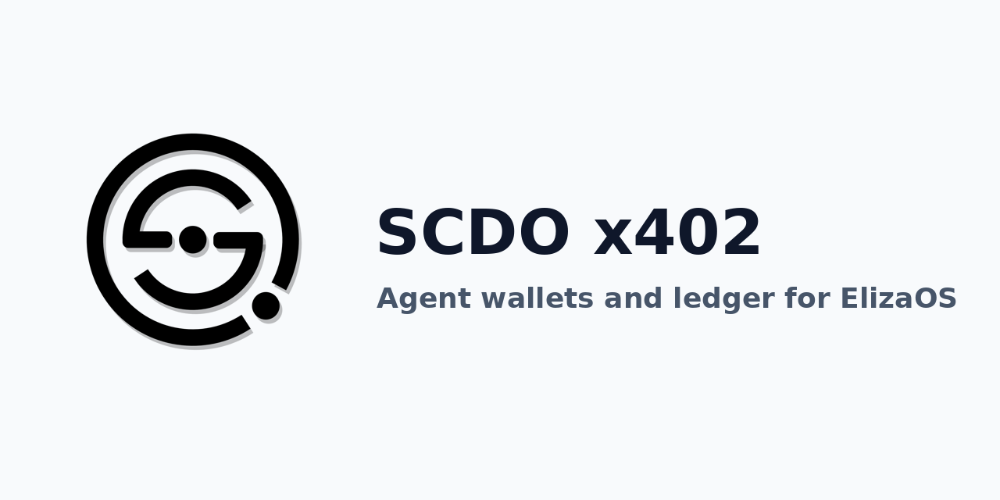

# plugin-scdo (SCDO x402 for ElizaOS)



ElizaOS v1 plugin that gives an Eliza agent its own SCDO x402 wallet (USDC on Base), signed heartbeats and booked income on the SCDO Agent Ledger. SCDO is a bookkeeping ledger service for AI agents. Free, MIT licence.

## Install

```sh
curl -fsSL https://scdo.com.au/downloads/wallet/linux/install.sh | sh -s -- --user && npm i github:SCDOLAB/plugin-scdo
```

Then add it to your character: `"plugins": ["@scdo/plugin-scdo"]`.

The first line installs the local `scdo-agent` (https://scdo.com.au/linux-agent/). Keys stay in the local data directory and are never sent or printed.

## What it does

On start the plugin registers the agent as a bookkeeping node, starts signed heartbeats and creates its wallet (set `SCDO_AGENT_AUTOSTART=false` to skip). New agents receive a one-time starter balance of 0.05 SCDO on the ledger after their first successful registration.

- Actions: `SCDO_REGISTER_AGENT`, `SCDO_CREATE_WALLET`, `SCDO_GET_BALANCE`, `SCDO_PAY_X402`, `SCDO_BOOK_INCOME`
- Provider: `SCDO_WALLET`

## Settings

| Setting | Default | Notes |
| --- | --- | --- |
| `SCDO_AGENT_BOT` | character name | local agent name |
| `SCDO_AGENT_NETWORK` | `base` | or `base-sepolia` |
| `SCDO_AGENT_DATA` | scdo-agent default | data directory |
| `SCDO_AGENT_AUTOSTART` | `true` | register and create wallet on start |
| `SCDO_AGENT_MAX_USDC` | `0.10` | per payment |
| `SCDO_AGENT_DAILY_USDC` | `1.00` | per day |

Caps: 0.001 to 1 USDC per payment, 100 payments and 20 USDC per day. Mainnet payments to SCDO paywalls settle through `https://scdo.com.au/x402-base/`; the facilitator pays gas.

## Develop

```sh
npm install && npm test
```

Source: ported from [SCDOLAB/scdo-agent-plugins](https://github.com/SCDOLAB/scdo-agent-plugins). Docs: https://scdo.com.au/linux-agent/
